# Launch

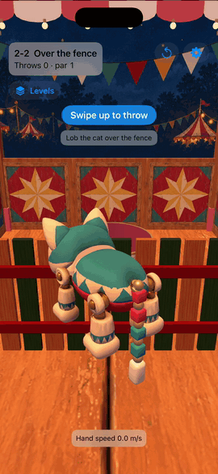

**Launch** is a first-person throwing game for iPhone where the phone *is* your hand. Hold it like the object, swing, and the game reads your real throw from the motion sensors: speed, angle and spin. Toss a ping-pong ball into a cup, lob a jointed wooden toy cat over a fence (it rights itself mid-air and lands on its feet), and throw knives at a spinning carnival wheel, all inside a hand-painted *Clockwork Carnival* booth.

This repo is the public window into the game's development. The source is private.

## Latest builds

<!-- builds:start -->
- 2026-10-13 · build 2 · Art: 13 new models (basket, booth_post, bulb +10), cat, prop textures, style exploration +2 · Levels · Throwables · Motion controls · Engine · UI · Art pipeline · Project · Docs — 2 commits

[Full build log →](BUILDLOG.md)
<!-- builds:end -->

Each push to the game's main branch adds a line automatically, written from which *areas* changed (art, levels, engine…), never from commit messages.

## Gameplay

The clips below are **scripted throws**: real committed builds running in the iOS Simulator, driven through the game's own swipe-to-throw input with aim and speed picked by the game's physics checker. On a phone you throw with your arm instead. Click a GIF for the full-quality MP4.

| 1-2 The cup | 1-3 Side ramps | 2-2 Over the fence | 2-4 Hole & kick *(setup only)* |
|:---:|:---:|:---:|:---:|
| [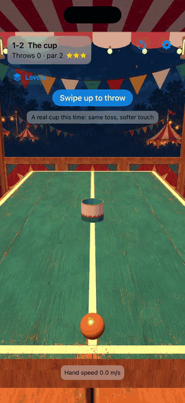](media/gameplay/1-2-the-cup.mp4) | [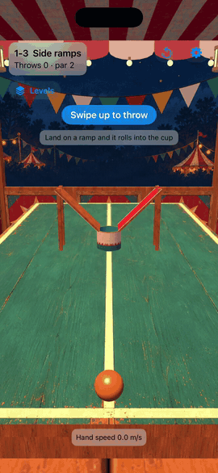](media/gameplay/1-3-side-ramps.mp4) |  | [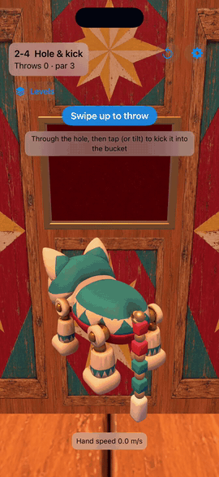](media/gameplay/2-4-hole-and-kick-setup.mp4) |
| A soft underhand toss | Land on a ramp, roll in | The cat rights itself and lands | Through the hole, then slow-mo: *tap to kick* |

*2-4 stops at the kick prompt: the kick needs split-second timing by the player, which the capture rig can't script yet.*

## Progress timelapse

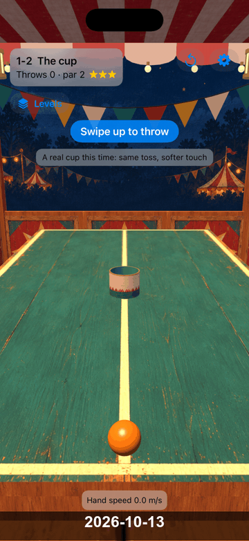

The same scene (1-2 *The cup*), built from the last commit of each active day and stamped with its date. It gains a frame every day there's work.

## Cast & art

### Finding the look
Three art directions were explored for the same scene. **Clockwork Carnival** (right) won.

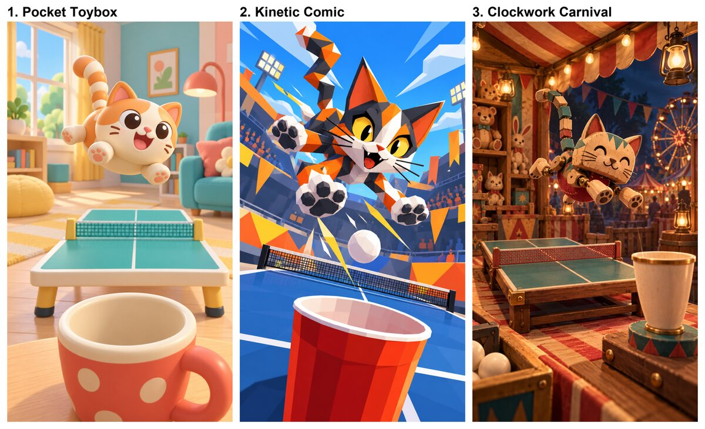

### The cat: concept → turnaround → 3D model
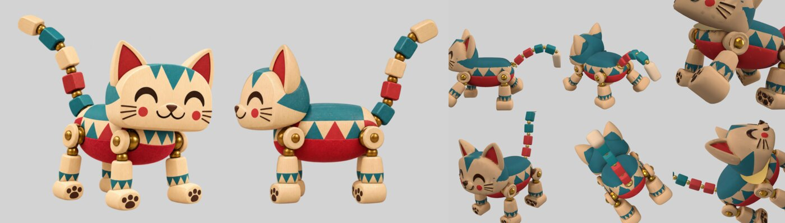
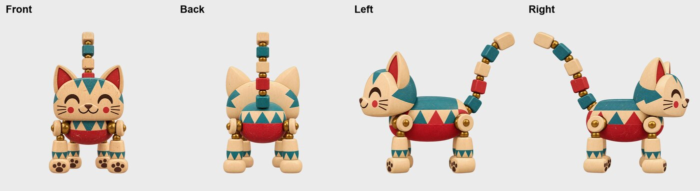

Concept candidates that didn't make it

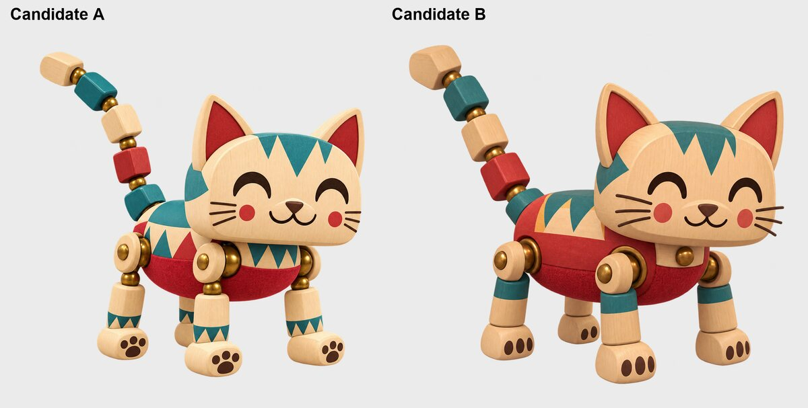

### Shipped models
Every prop as it ships in the game, rendered by SceneKit straight from the build's `.usdz` files.

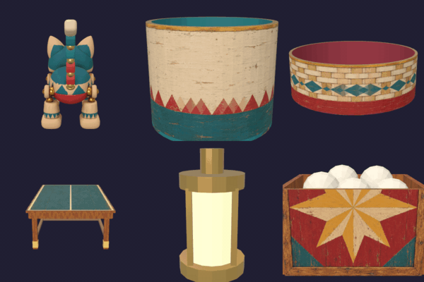

### The booth: concept vs. game
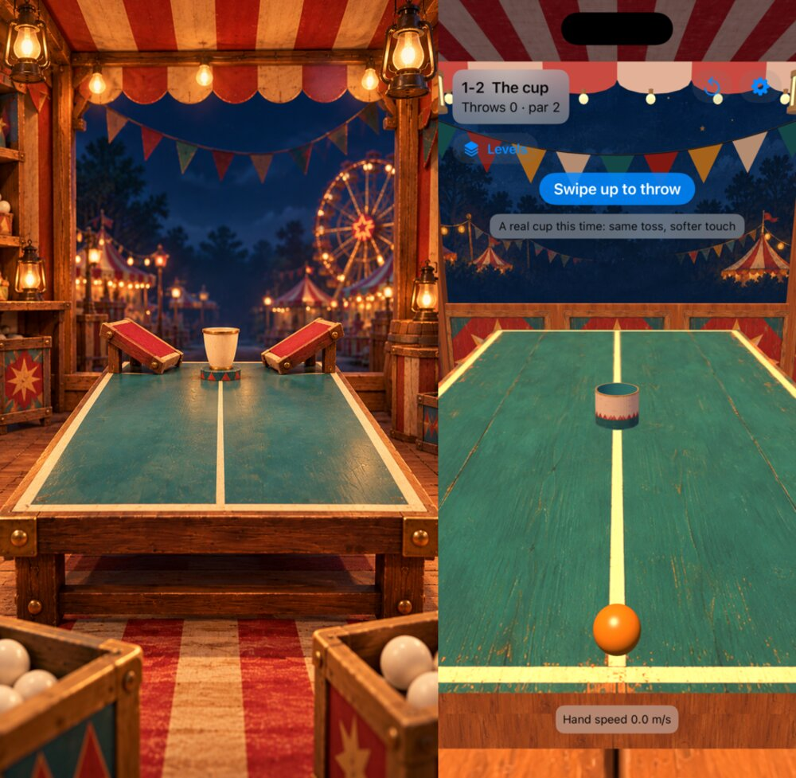

Booth concept candidates

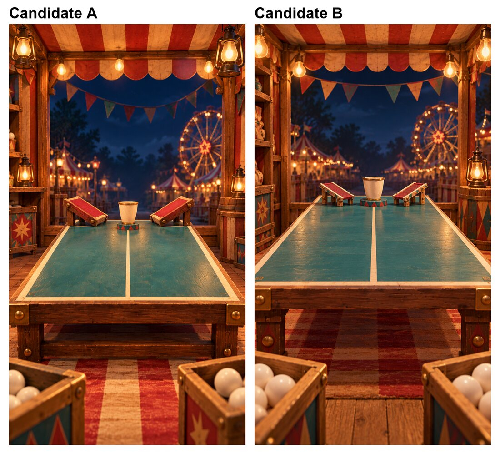

### Textures
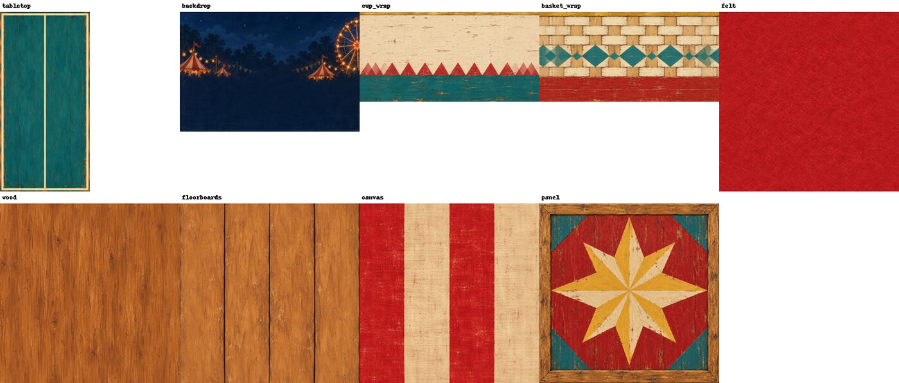

## Devlog

Longer posts about how things were built: see **[DEVLOG.md](DEVLOG.md)**.

---

© 2026 Marco Battiato. **All rights reserved.** Everything here (images, video, text) is shown for viewing only. No licence is granted to copy, modify or redistribute it.
